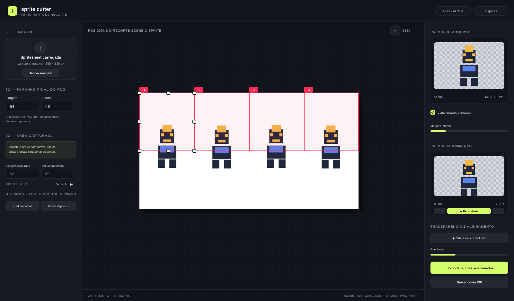
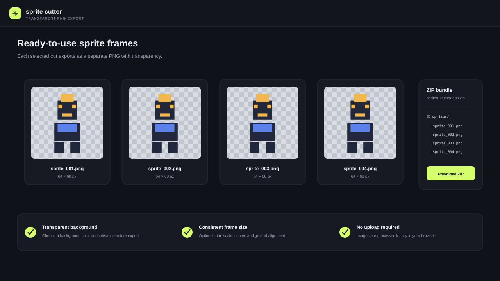

# Sprite Cutter

Sprite Cutter is a small, browser-based tool for preparing sprite frames from a spritesheet. Load an image, place one or more crop boxes over the characters, preview the resulting PNGs, and export the frames individually or as a ZIP archive.

The interface is in Brazilian Portuguese (`pt-BR`). The tool has no build step, server, or third-party runtime dependencies: open `index.html` in a modern browser to use it. Image decoding, crop previews, transparency processing, and ZIP creation happen locally in the browser.

## UI previews

These repository assets are illustrative SVG previews based on the app's actual layout and controls. They are not live browser captures. The sprite artwork in the previews is sample artwork.

## Features

- **Load a spritesheet:** choose a file or drag it into the upload area. The interface accepts PNG, JPEG, WebP, and GIF image files.
- **Place crops by hand:** click the spritesheet to add a crop centered around the pointer. Drag an existing crop to reposition it. Crop boxes stay within the image bounds.
- **Set crop dimensions:** change the shared width and height for the crop boxes. The defaults are 64 × 68 pixels.
- **Use a guide grid:** turn on the auxiliary grid and adjust cell spacing and offsets to help line up crops with a sheet's layout.
- **Arrange frames:** select a crop to make it active, move it earlier or later in the frame order, or remove one or clear all crops.
- **Preview output:** inspect the active crop as a PNG and preview the crop sequence as an animation. Animation speed is adjustable from 1 to 24 FPS; it starts at 8 FPS.
- **Remove a flat background:** sample a color from the spritesheet and adjust the tolerance. Similar pixels become transparent, with partial alpha at the edge of the tolerance range to soften the cutout.
- **Fit characters into a consistent frame:** the enabled-by-default fit option trims transparent or removed-background space, scales the remaining content proportionally, centers it horizontally, and aligns it to the ground guide. The exported canvas keeps the configured crop dimensions. Internal padding is adjustable.
- **Export frames:** save separate `sprite_001.png`, `sprite_002.png`, … files to a chosen folder when the browser supports folder access, or download `sprites_recortados.zip`. The ZIP contains the PNGs in a `sprites/` directory.
- **Zoom and fit:** zoom the sheet in or out and fit it into the workspace.

## Quick start

1. Download or clone this repository.
2. Open `index.html` in a current desktop browser.
3. Select a PNG, JPEG, WebP, or GIF spritesheet, or drag one into the upload area.
4. Set the crop width and height. Turn on the auxiliary grid and adjust its spacing or offsets if the sheet has a regular layout.
5. Click each character to add a crop. Drag crop boxes to fine-tune their positions. Reorder frames if needed.
6. Review the PNG preview. If the artwork needs cleanup, sample its background color and adjust the tolerance. Keep **Cortar espaços extras e encaixar** enabled to normalize the character's size and baseline within each output frame.
7. Use **Exportar sprites selecionados** to save to a folder where supported, or **Baixar como ZIP** to download an archive.

## How the crop and preview work

Each click on the sheet creates a crop centered on the pointer using the current width and height. When the pointer lands on an existing crop, dragging moves that crop instead. Crop order determines the animation order and the numbering of exported files.

When content fitting is enabled, the preview removes transparent space around the character, scales the remaining content proportionally to fit the output frame and padding, centers it, and places its feet near the configured ground line. The default output frame is 64 × 68 pixels with 2 pixels of internal padding and a ground position of 60 pixels. These values can be adjusted in the interface.

The background color picker lets you sample a pixel from the loaded image. The tolerance slider controls how close a pixel's color must be to the sampled color before it is made transparent. If fitting is enabled and no color was sampled, the app estimates a background color from the crop's border. Review the preview, especially around fine outlines or colors close to the background, before exporting.

## Project files

| File | Purpose |
| --- | --- |
| `index.html` | Page structure, interface copy, styling, and responsive layout. |
| `app.js` | Image loading, crop placement, previews, animation, transparency processing, and exports. |
| `screenshots/` | Illustrative SVG previews included in this README. |

## Technical notes

- Built with plain HTML, CSS, and JavaScript; no bundler or package installation is required.
- Uses the browser's Canvas API for image rendering and PNG generation.
- Uses the File System Access API for folder export when it is available; otherwise, the folder-export action falls back to ZIP download.
- The ZIP archive is assembled in the browser without a ZIP library.
- The tool does not upload the selected spritesheet to a server.

## Limitations

- Crop boxes are placed manually; the auxiliary grid is a visual alignment guide and does not automatically detect characters.
- Background removal is based on color similarity, so colors in the sprite that resemble the chosen background can also be removed. Check the preview and adjust the tolerance.
- Folder export depends on browser support. ZIP download is the fallback.
- The app is intended for modern desktop browsers. Its layout adapts to narrower screens, though the crop workflow is easier with a larger viewport.
