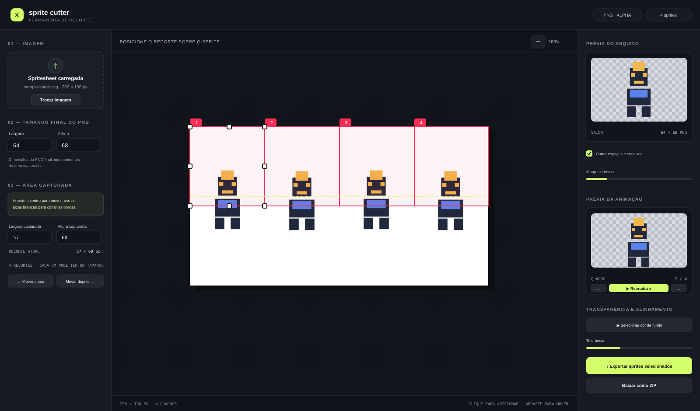
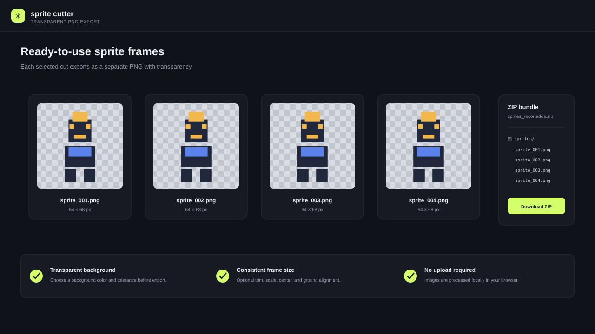

# Sprite Cutter

O Sprite Cutter é uma ferramenta para preparar quadros de sprites a partir de uma spritesheet. Carregue uma imagem, posicione um ou mais recortes sobre os personagens, confira a prévia dos PNGs e exporte os quadros individualmente ou em um arquivo ZIP.

A interface está em português do Brasil (`pt-BR`). Não é necessário instalar dependências, compilar o projeto nem iniciar um servidor: basta abrir o arquivo `index.html` em um navegador moderno. O carregamento e o processamento das imagens, as prévias, a remoção do fundo e a criação do ZIP acontecem localmente no navegador.

> [Leia esta documentação em inglês](README-en.md).

## Prévia da interface

As imagens abaixo são ilustrações em SVG baseadas no layout e nos controles reais do aplicativo; elas não são capturas de tela ao vivo. Os personagens mostrados são desenhos de exemplo.

## Funcionalidades

- **Carregue uma spritesheet:** selecione um arquivo ou arraste-o para a área de envio. São aceitas imagens PNG, JPEG, WebP e GIF.
- **Posicione os recortes manualmente:** clique na spritesheet para criar um recorte centralizado no ponteiro. Arraste um recorte existente para reposicioná-lo. Os recortes permanecem dentro dos limites da imagem.
- **Defina o tamanho dos recortes:** altere a largura e a altura compartilhadas entre os recortes. O tamanho inicial é 64 × 68 pixels.
- **Use uma grade auxiliar:** ative a grade e ajuste espaçamentos e margens para ajudar a alinhar os recortes com a organização da spritesheet.
- **Organize os quadros:** selecione um recorte para torná-lo ativo, mova-o para antes ou depois na sequência, remova o recorte atual ou limpe todos os recortes.
- **Confira o resultado:** visualize o PNG do recorte atual e reproduza a sequência como animação. A velocidade pode ser ajustada de 1 a 24 FPS; o padrão é 8 FPS.
- **Remova uma cor de fundo uniforme:** escolha uma cor na spritesheet e ajuste a tolerância. Pixels de cor semelhante ficam transparentes, com transparência parcial nas bordas para suavizar o recorte.
- **Encaixe os personagens em quadros consistentes:** a opção de encaixe, ativada por padrão, remove o espaço transparente ou o fundo removido, redimensiona o conteúdo proporcionalmente, centraliza o personagem e alinha seus pés à linha de chão. A imagem exportada mantém as dimensões configuradas para o recorte. O preenchimento interno pode ser ajustado.
- **Exporte os quadros:** salve arquivos separados como `sprite_001.png`, `sprite_002.png` e assim por diante em uma pasta, quando houver suporte no navegador, ou baixe `sprites_recortados.zip`. O ZIP contém os PNGs em uma pasta `sprites/`.
- **Ajuste a visualização:** aumente ou diminua o zoom e encaixe a spritesheet na área de trabalho.

## Como começar

1. Baixe ou clone este repositório.
2. Abra `index.html` em um navegador moderno para computador.
3. Selecione uma spritesheet PNG, JPEG, WebP ou GIF, ou arraste o arquivo para a área de envio.
4. Defina a largura e a altura do recorte. Se a folha tiver uma organização regular, ative a grade auxiliar e ajuste o espaçamento e as margens.
5. Clique em cada personagem para criar um recorte. Arraste os recortes para acertar a posição e reorganize os quadros se necessário.
6. Confira a prévia do PNG. Para remover o fundo, selecione sua cor e ajuste a tolerância. Mantenha **Cortar espaços extras e encaixar** ativado para padronizar o tamanho do personagem e a linha dos pés.
7. Use **Exportar sprites selecionados** para salvar em uma pasta, quando houver suporte, ou **Baixar como ZIP** para baixar um arquivo compactado.

## Recortes e prévias

Cada clique na imagem cria um recorte centralizado no ponteiro, usando a largura e a altura atuais. Se o ponteiro estiver sobre um recorte existente, arraste para movê-lo. A ordem dos recortes define a sequência da animação e a numeração dos arquivos exportados.

Com o encaixe de conteúdo ativado, o aplicativo remove os espaços transparentes ao redor do personagem, redimensiona proporcionalmente o conteúdo para caber no quadro e no preenchimento definido, centraliza-o e posiciona os pés perto da linha de chão. O quadro de saída continua com o tamanho configurado. Por padrão, o quadro mede 64 × 68 pixels, o preenchimento interno é de 2 pixels e a linha de chão fica na posição vertical de 60 pixels. Esses valores podem ser alterados na interface.

O seletor de cor de fundo permite escolher um pixel da imagem carregada. A tolerância define o quanto a cor de cada pixel pode diferir da cor escolhida para que ele fique transparente. Se o encaixe estiver ativado e nenhuma cor tiver sido selecionada, o aplicativo estima a cor de fundo a partir das bordas do recorte. Confira a prévia, principalmente em contornos delicados ou cores parecidas com o fundo.

## Arquivos do projeto

| Arquivo | Descrição |
| --- | --- |
| `index.html` | Estrutura da página, textos da interface, estilos e layout responsivo. |
| `app.js` | Carregamento de imagens, posicionamento de recortes, prévias, animação, transparência e exportação. |
| `README-en.md` | Documentação em inglês. |
| `screenshots/` | Prévia ilustrativa da interface, prévia da exportação e spritesheet de exemplo. |

## Detalhes técnicos

- Desenvolvido com HTML, CSS e JavaScript sem bibliotecas de terceiros ou etapa de compilação.
- Usa a Canvas API do navegador para renderizar imagens e gerar PNGs.
- Usa a File System Access API para salvar em uma pasta quando o navegador oferece suporte. Caso contrário, a exportação pela pasta usa o download de ZIP como alternativa.
- O arquivo ZIP é criado no próprio navegador, sem uma biblioteca de compactação.
- A spritesheet selecionada não é enviada para um servidor.

## Limitações

- Os recortes são posicionados manualmente. A grade auxiliar ajuda no alinhamento, mas não detecta personagens automaticamente.
- A remoção do fundo compara cores; por isso, partes do sprite que tenham cores parecidas com o fundo selecionado também podem ficar transparentes. Confira a prévia e ajuste a tolerância.
- A exportação para uma pasta depende do suporte do navegador. O download de ZIP é a alternativa.
- O aplicativo foi pensado para navegadores modernos em computadores. O layout se adapta a telas menores, mas o fluxo de recorte é mais fácil em uma janela maior.
